# DADS7202: Sport Image Classification with CNN 🏅 (Group ✏️ GROUP_NAME)

> **Which pre-trained CNN classifies 10 sports most accurately — and does fine-tuning the last block beat a frozen backbone?**

<p align="center">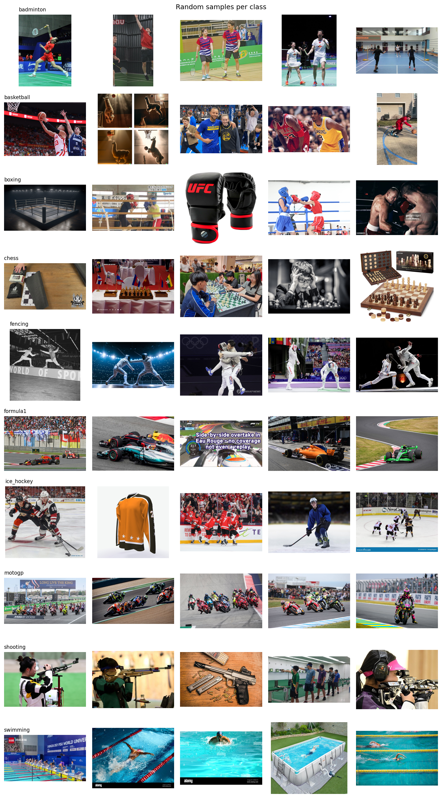</p>

## ✨Highlight

<!-- AUTO:highlight -->
1. **After W&B Sweep tuning + 5 seeds per model**, the best model is **🏆ResNet50** with test Macro-F1 **96.64 ± 0.19%** and accuracy **96.61 ± 0.19%** (mean ± SD).
2. ResNet50 vs. runner-up MobileNetV2 on Macro-F1: p = 0.0037, significant after Bonferroni (Welch's t-test, Bonferroni α = 0.0083).
3. The lightest model, **MobileNetV2** (2.55M params, 1.78 ms/img), reaches Macro-F1 95.34 ± 0.54%.
4. **Fine-tuning the last block vs. a frozen backbone** (Macro-F1 difference, 95% CI): VGG16 +0.28 [-0.15, +0.70] pp; MobileNetV2 +1.99 [+1.28, +2.70] pp; ResNet50 +0.39 [+0.14, +0.63] pp.
<!-- /AUTO:highlight -->
- ✏️ One sentence on what Grad-CAM shows (Section 5.6)

## Table of Contents

- [1. Introduction🎯](#1-introduction)
- [2. Data📑](#2-data)
- [3. Network architecture📦](#3-network-architecture)
- [4. Training🔮](#4-training)
- [5. Results📈](#5-results)
- [6. Discussion💭](#6-discussion)
- [7. Conclusion📝](#7-conclusion)
- [8. References🌐](#8-references)
- [Citing](#citing)
- [👥 Members, Percent Contribution and Responsibility](#members)
- [🖇️ End Credit](#end-credit)
- 📓 Notebook: [`DADS7202_HW_Sport_CNN_v3.ipynb`](DADS7202_HW_Sport_CNN_v3.ipynb)

---

## 1. Introduction🎯

- **Task:** `multi-class image classification` of sport photos into **10 classes**: badminton, basketball, boxing, chess, fencing, formula1, ice_hockey, motogp, shooting and swimming.
- **Approach:** transfer learning from ImageNet with **3 CNN backbones of very different design**: VGG16, ResNet50 and MobileNetV2. The original classifier is replaced with a new head, and two training strategies are compared:
  - `frozen`: the whole backbone is frozen and only the new head is trained (feature extraction).
  - `last_block`: the last convolutional block is unfrozen and fine-tuned together with the head.
- **Tuning:** hyperparameters are tuned with a **W&B Sweep (Bayesian)**, run separately for each architecture × strategy with the same budget.
- **Evaluation:** each final configuration is re-trained with **5 seeds** and reported as **mean ± SD** on a held-out test set, with Welch's t-tests between models.
- **Interpretation:** we use **Grad-CAM**, eyeball analysis and error analysis to check *why* the models decide as they do.

[🔝](#highlight)

---

## 2. Data📑

### 2.1 Data source

All images were collected from the web and pre-filtered with CLIP before entering the notebook:

1. **Collection:** images were downloaded with **[icrawler](https://github.com/hellock/icrawler)** from **Bing** (photo filter on) and **Baidu**, using about 10 keywords per class (up to 100 images per keyword per engine). The keywords mix several angles and contexts (match, action shot, venue) and several languages (English, Thai, Chinese, Japanese, Spanish, Russian, …), so that no single source dominates. Corrupt files, images with a short side < 64 px and pHash duplicates were then removed. A duplicate that appeared in two classes was dropped entirely.
2. **Relevance filtering:** **[`openai/clip-vit-large-patch14`](https://huggingface.co/openai/clip-vit-large-patch14)** (CLIP ViT-L/14) was used zero-shot as a *flagging* tool. Each image was scored against 3 prompt templates per sport (e.g. "an action shot of {sport}") and 12 "junk" prompts (cartoon, product photo, empty stadium, logo/text, video game, …). An image was flagged as **junk** if p(junk) ≥ 0.60, or as **mismatch** if CLIP predicted another sport with p ≥ 0.80 while the given label had p ≤ 0.10. Flagged images were **checked by eye**, and only those confirmed as wrong were moved out (not deleted). The same prompts and thresholds were used for every image, before splitting.
3. **Duplicate removal:** **[`openai/clip-vit-base-patch32`](https://huggingface.co/openai/clip-vit-base-patch32)** (CLIP ViT-B/32) image embeddings were compared by cosine similarity. Pairs with similarity > 0.95 were listed as near-duplicates for removal. This catches re-crops and edits that pHash misses.

The notebook then applies its own cleaning (Section 2.3), with MD5 for exact copies and dHash for resized copies across splits.

| Class | Source(s) | # images (after cleaning) | Note |
|---|---|:-:|---|
| badminton | Web (icrawler) | 771 | |
| basketball | Web (icrawler) | 817 | |
| boxing | Web (icrawler) | 691 | |
| chess | Web (icrawler) | 904 | |
| fencing | Web (icrawler) | 870 | |
| formula1 | Web (icrawler) | 671 | |
| ice_hockey | Web (icrawler) | 770 | |
| motogp | Web (icrawler) | 795 | |
| shooting | Web (icrawler) | 686 | |
| swimming | Web (icrawler) | 702 | |

### 2.2 Exploratory data analysis

<p align="center">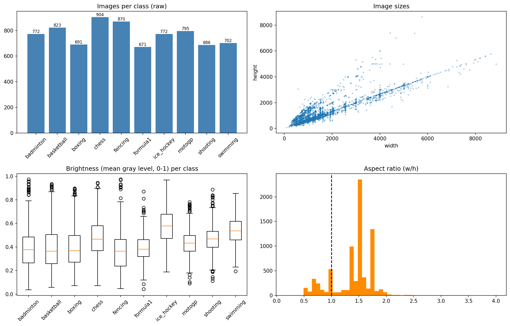</p>

<!-- AUTO:imbalance -->
After cleaning: **7,677 images**; largest class **chess** (904), smallest **formula1** (671) → imbalance ratio (max/min) = **1.35**.
<!-- /AUTO:imbalance -->

To handle class imbalance, we:
1. use a **stratified split**, so every split keeps the same class proportions;
2. use **class-weighted cross-entropy**, with weights $w_c = N / (K \cdot n_c)$ computed from the train split only;
3. report imbalance-robust metrics: **Macro-F1** (primary), balanced accuracy and per-class precision/recall.

### 2.3 Data cleaning

1. Remove unreadable or corrupt files.
2. Remove images whose short side is < 64 px.
3. Remove exact duplicates (same MD5). If the same file appears in two classes, every copy is dropped because the labels conflict.
4. *(Optional)* Remove near-duplicates, i.e. resized or re-encoded copies, using a perceptual hash (dHash, Hamming distance ≤ 4).
5. Fix the EXIF orientation, convert to RGB, and downscale so the short side is ≤ 512 px.

A **near-duplicate leakage check** then compares the dHash of every image across train/val/test, because MD5 cannot detect a resized copy of the same photo:

<!-- AUTO:leak -->
> ⚠️ **4 near-duplicate pair(s) across splits** (1 involving the test set). They were **kept** (`REMOVE_NEAR_DUPLICATES = False`) and are reported as a limitation: all pairs have the same label, and 1 of the 1,152 test images has a near-copy in another split, so the effect on test accuracy is at most 1/1,152 ≈ 0.09 pp.

<p align="center">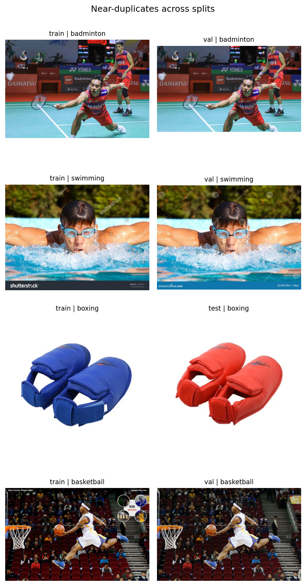</p>
<!-- /AUTO:leak -->

This is well below the 1.30 pp gap between ResNet50 and MobileNetV2 (Section 5.4), so the leak cannot change the ranking of the models.

### 2.4 Data splitting (train / val / test)

- **Stratified random split 70 / 15 / 15** (`random_state = 42`).
- The **same split is used for every architecture and seed**, so the run-to-run variation comes only from training randomness.
- The test set is used **only for the final evaluation**. Hyperparameters, the best epoch and the strategy are all chosen on validation.

<!-- AUTO:split -->
| Class | train | val | test | total |
|---|:-:|:-:|:-:|:-:|
| badminton | 539 | 116 | 116 | 771 |
| basketball | 572 | 123 | 122 | 817 |
| boxing | 484 | 104 | 103 | 691 |
| chess | 633 | 135 | 136 | 904 |
| fencing | 609 | 130 | 131 | 870 |
| formula1 | 470 | 100 | 101 | 671 |
| ice_hockey | 539 | 116 | 115 | 770 |
| motogp | 556 | 119 | 120 | 795 |
| shooting | 480 | 103 | 103 | 686 |
| swimming | 491 | 106 | 105 | 702 |
| **Total** | 5373 | 1152 | 1152 | 7677 |
<!-- /AUTO:split -->

### 2.5 Pre-processing & data augmentation

| | Train (online augmentation) | Val / Test |
|---|---|---|
| Geometry | `RandomResizedCrop(224, scale=(0.5, 1))`, `RandomHorizontalFlip(0.5)`, `RandomRotation(±10°)` | `Resize(256)` → `CenterCrop(224)` |
| Photometric | `ColorJitter(brightness 0.3, contrast 0.3, saturation 0.2, hue 0.02)` | — |
| Normalization | ImageNet mean / std | same |

Sport photos vary in camera angle, zoom and lighting, so we use scale crops, horizontal flips, small rotations and colour jitter. Vertical flips and large rotations are not used because they produce unnatural images.

<p align="center">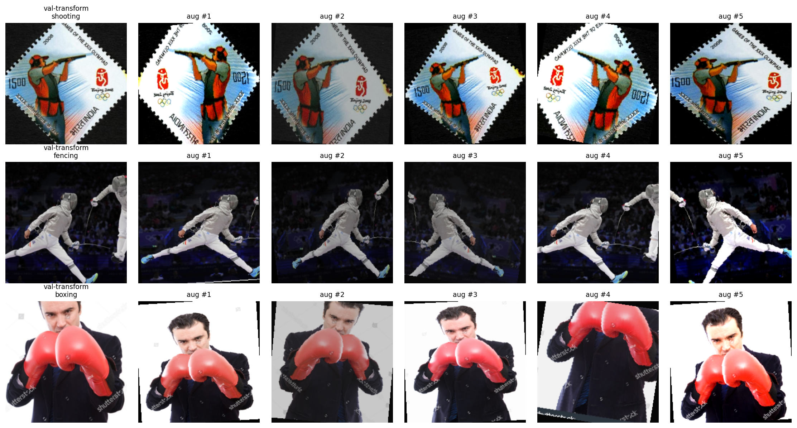</p>

[🔝](#highlight)

---

## 3. Network architecture📦

### 3.1 Pre-trained backbones

| Backbone | Year | Params | Key idea | Why chosen |
|---|:-:|:-:|---|---|
| **VGG16** | 2014 | ~138M (original) | Plain stack of 3×3 convs (13 conv layers) | Classic baseline; the model used for Grad-CAM in class |
| **ResNet50** | 2015 | ~25.6M | Residual (skip) connections + bottleneck blocks | Deep yet easy to train; a standard high-accuracy CNN |
| **MobileNetV2** | 2018 | ~3.5M | Depthwise-separable convs + inverted residuals | Light and fast; suitable for resource-constrained devices |

### 3.2 Pre-trained models without fine-tuning

Before any training, the original ImageNet models predict ImageNet classes (e.g. `racket`, `puck`, `scuba_diver`), and none of their outputs corresponds directly to our 10 sport classes. The classifier therefore has to be replaced.

<p align="center">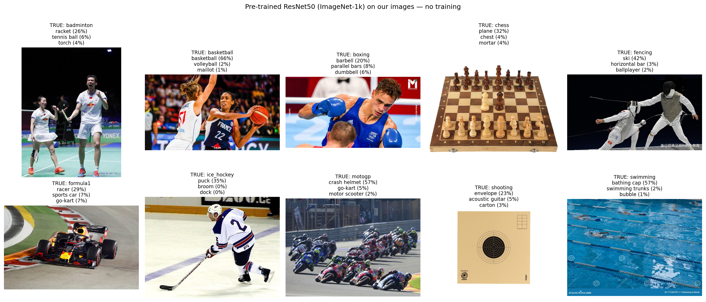</p>

✏️ *One or two sentences on what the table / figure in notebook Section 3.2 shows.*

### 3.3 Modified architecture (backbone cut + new head)

| Backbone | Kept (ImageNet weights) | Removed | New head | Unfrozen in `last_block` |
|---|---|---|---|---|
| VGG16 | `features` + `avgpool` → 25,088-d | `classifier` (FC 4096→4096→1000) | `Linear(25088, H) → ReLU → Dropout(p) → Linear(H, 10)` | `features[24:]` (conv block 5) |
| ResNet50 | conv1 … layer4 + avgpool → 2,048-d | `fc` (2048→1000) | `Linear(2048, H) → ReLU → Dropout(p) → Linear(H, 10)` | `layer4` |
| MobileNetV2 | `features` + global avgpool → 1,280-d | `classifier` (1280→1000) | `Linear(1280, H) → ReLU → Dropout(p) → Linear(H, 10)` | `features[14:]` |

The **same head structure** is used for all 3 backbones, so only the backbones differ. `H` and `p` are tuned by the sweep. BatchNorm layers in the frozen part stay in `eval()` mode, so the ImageNet running statistics are not changed.

<p align="center">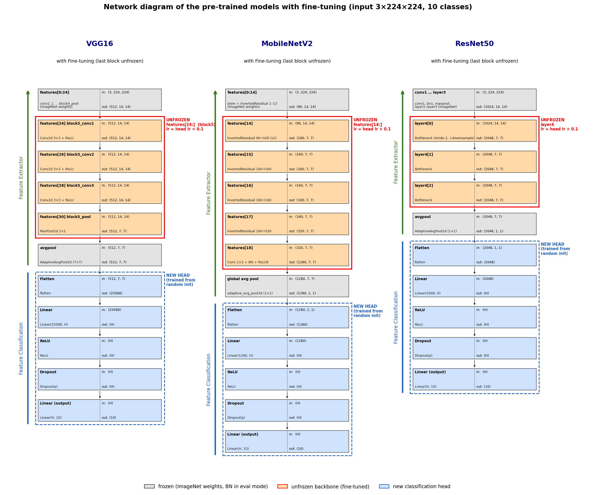</p>

[🔝](#highlight)

---

## 4. Training🔮

### 4.1 Training setup

| Item | Setting |
|---|---|
| Loss | Class-weighted cross-entropy (weights from the train split) |
| Optimizer | AdamW: head LR = `lr`, LR of the unfrozen backbone block = `lr × 0.1` |
| LR scheduler | CosineAnnealingLR (T_max = epochs) |
| Epochs / batch size | 12 / 32 (fixed) |
| Model selection | Checkpoint of the epoch with the highest **val macro-F1** |
| Hardware | ✏️ e.g. Mac mini (Apple M_, MPS) / Colab T4 |

### 4.2 Hyperparameter tuning: W&B Sweep (Bayesian)

To compare `frozen` and `last_block` fairly, **one sweep is run per architecture per strategy** (6 sweeps) with the same budget of **10 runs each**, instead of letting a single sweep choose the strategy. The objective is the best val macro-F1 (single seed = 42).

| Parameter | Search space |
|---|---|
| `lr` | log-uniform [1e-4, 2e-3] |
| `weight_decay` | {1e-4, 1e-2} |
| `hidden` (H) | {256, 512} |
| `dropout` (p) | {0.3, 0.5} |

**Best configuration per architecture × strategy** (from the sweeps):

<!-- AUTO:cfg -->
| Model | Strategy | lr | weight_decay | hidden (H) | dropout (p) |
|---|:-:|:-:|:-:|:-:|:-:|
| VGG16 | `frozen` | 1.28e-04 | 0.0001 | 512 | 0.5 |
| VGG16 | `last_block` ✅ | 1.50e-03 | 0.0001 | 512 | 0.3 |
| MobileNetV2 | `frozen` | 1.52e-03 | 0.01 | 512 | 0.3 |
| MobileNetV2 | `last_block` ✅ | 1.70e-03 | 0.0001 | 256 | 0.5 |
| ResNet50 | `frozen` | 1.05e-03 | 0.01 | 512 | 0.3 |
| ResNet50 | `last_block` ✅ | 9.84e-04 | 0.0001 | 512 | 0.5 |

> ✅ = strategy selected as the main model (higher mean val macro-F1 over the 5 seeds).
<!-- /AUTO:cfg -->

### 4.3 Final runs and strategy selection

1. The best configuration of **both strategies** is re-trained from scratch with **5 seeds** (`0–4`).
2. For each architecture, the strategy with the higher **mean val macro-F1** becomes the main model. The choice is made on validation only, never on test.
3. Results are reported on the test set as mean ± SD over the 5 seeds.

🔗 W&B project: [wandb.ai/tetravaal/DADS7202_HW_SportCNN_5](https://wandb.ai/tetravaal/DADS7202_HW_SportCNN_5) (6 sweeps + 30 final runs)

[🔝](#highlight)

---

## 5. Results📈

### 5.1 Test performance (mean ± SD over 5 seeds)

<!-- AUTO:summary -->
| Model | strategy | Accuracy (%) | Balanced Acc (%) | Macro F1 (%) | Weighted F1 (%) | Top-3 Acc (%) | Params (M) | Trainable (M) | Latency (ms/img) |
|---|:-:|:-:|:-:|:-:|:-:|:-:|:-:|:-:|:-:|
| 🏆 **ResNet50** | last_block | 96.61 ± 0.19 | 96.64 ± 0.20 | 96.64 ± 0.19 | 96.62 ± 0.19 | 99.34 ± 0.32 | 24.56 | 16.02 | 5.84 |
| **MobileNetV2** | last_block | 95.31 ± 0.53 | 95.35 ± 0.52 | 95.34 ± 0.54 | 95.34 ± 0.52 | 99.10 ± 0.17 | 2.55 | 2.01 | 1.78 |
| **VGG16** | last_block | 92.80 ± 0.14 | 92.70 ± 0.18 | 92.76 ± 0.15 | 92.82 ± 0.12 | 98.56 ± 0.21 | 27.57 | 19.93 | 8.75 |

> Ranked by mean test Macro-F1 (primary metric). SD = sample SD (ddof = 1). Latency = forward-pass time per image at batch size 32 (throughput, not single-image latency), measured on the training machine (Apple Silicon, MPS).
<!-- /AUTO:summary -->

### 5.2 Training curves

<p align="center">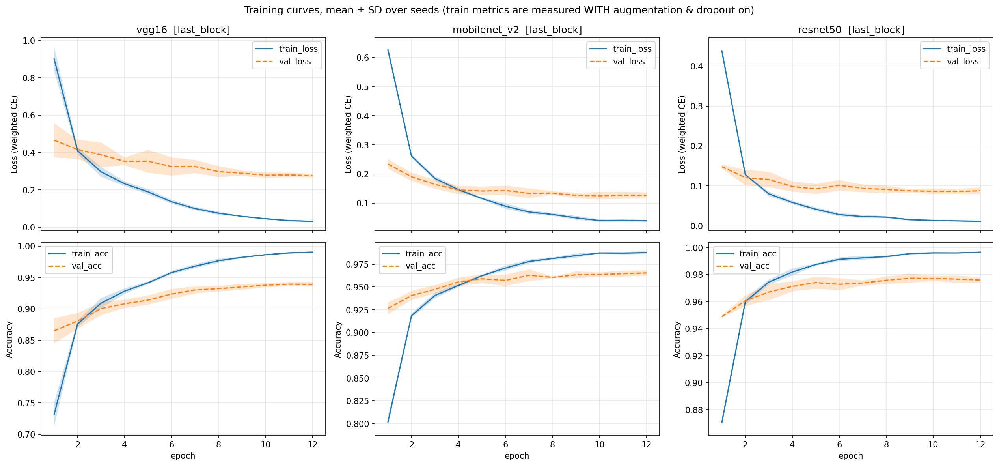</p>

> Train metrics are measured with augmentation and dropout on. At the final epoch, train accuracy exceeds validation accuracy by +5.1 pp (VGG16), +2.2 pp (MobileNetV2) and +2.1 pp (ResNet50). VGG16 overfits the most, likely because its new head takes the 25,088-d flattened feature map (~12.8M params in the first Linear layer).

### 5.3 Per-class performance & confusion matrices

<p align="center">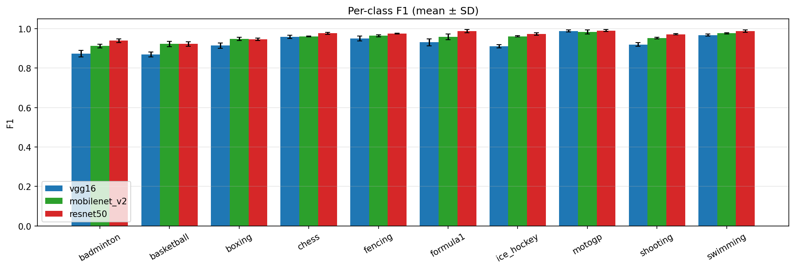</p>
<p align="center">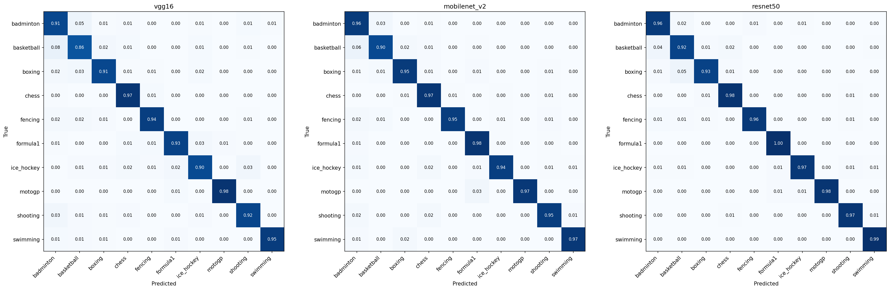</p>

<!-- AUTO:perclass -->
**Per-class F1 (%), mean ± SD**

| Class | VGG16 | MobileNetV2 | ResNet50 |
|---|:-:|:-:|:-:|
| badminton | 87.29 ± 1.58 | 91.20 ± 0.93 | 93.86 ± 0.94 |
| basketball | 86.86 ± 1.26 | 92.21 ± 1.34 | 92.25 ± 1.15 |
| boxing | 91.34 ± 1.32 | 94.70 ± 0.79 | 94.56 ± 0.57 |
| chess | 95.81 ± 0.84 | 96.01 ± 0.24 | 97.59 ± 0.48 |
| fencing | 94.93 ± 1.28 | 96.35 ± 0.52 | 97.37 ± 0.19 |
| formula1 | 92.99 ± 1.78 | 95.76 ± 1.40 | 98.73 ± 0.89 |
| ice_hockey | 91.01 ± 0.85 | 96.02 ± 0.34 | 97.28 ± 0.65 |
| motogp | 98.74 ± 0.50 | 98.30 ± 0.96 | 98.99 ± 0.49 |
| shooting | 91.92 ± 0.98 | 95.21 ± 0.43 | 97.10 ± 0.36 |
| swimming | 96.71 ± 0.54 | 97.60 ± 0.34 | 98.68 ± 0.61 |

- Weakest class for VGG16: **basketball** (86.86 ± 1.26%)
- Weakest class for MobileNetV2: **badminton** (91.20 ± 0.93%)
- Weakest class for ResNet50: **basketball** (92.25 ± 1.15%)
<!-- /AUTO:perclass -->

### 5.4 Statistical significance between architectures

Welch's t-test (two-sided) on test accuracy and Macro-F1 over the 5 seeds. A Bonferroni correction for 3 pairs × 2 metrics = 6 tests gives a threshold of **α = 0.05 / 6 ≈ 0.0083**.

<!-- AUTO:pvalues -->
| metric | pair | diff (pp) | p-value | significant (Bonferroni) |
|---|:-:|:-:|:-:|:-:|
| Accuracy | VGG16 vs MobileNetV2 | -2.52 | 0.0003 | ✅ |
| Accuracy | VGG16 vs ResNet50 | -3.82 | 0.0000 | ✅ |
| Accuracy | MobileNetV2 vs ResNet50 | -1.30 | 0.0035 | ✅ |
| Macro F1 | VGG16 vs MobileNetV2 | -2.58 | 0.0002 | ✅ |
| Macro F1 | VGG16 vs ResNet50 | -3.88 | 0.0000 | ✅ |
| Macro F1 | MobileNetV2 vs ResNet50 | -1.30 | 0.0037 | ✅ |
<!-- /AUTO:pvalues -->

### 5.5 Ablation: frozen backbone vs. fine-tuning the last block

The mean difference is `last_block − frozen` on the test set, with a Welch 95% CI, a Bonferroni-adjusted p-value (× 3 architectures) and Cohen's d.

<!-- AUTO:strategy -->
| metric | model | frozen (mean ± SD) [95% CI] % | last_block (mean ± SD) [95% CI] % | diff LB−FZ (pp) [95% CI] | p (Welch) | p adj (Bonferroni ×3) | Cohen's d |
|---|:-:|:-:|:-:|:-:|:-:|:-:|:-:|
| test macro-F1 | VGG16 | 92.48 ± 0.35 [92.05, 92.91] | 92.76 ± 0.15 [92.58, 92.95] | +0.28 [-0.15, +0.70] | 0.1553 | 0.466 | 1.04 |
| test macro-F1 | MobileNetV2 | 93.34 ± 0.42 [92.82, 93.87] | 95.34 ± 0.54 [94.67, 96.00] | +1.99 [+1.28, +2.70] | 0.0002 | 0.0007 | 4.13 |
| test macro-F1 | ResNet50 | 96.25 ± 0.15 [96.07, 96.43] | 96.64 ± 0.19 [96.41, 96.87] | +0.39 [+0.14, +0.63] | 0.007 | 0.0209 | 2.32 |
| test accuracy | VGG16 | 92.50 ± 0.36 [92.05, 92.95] | 92.80 ± 0.14 [92.62, 92.97] | +0.30 [-0.15, +0.74] | 0.1467 | 0.4402 | 1.08 |
| test accuracy | MobileNetV2 | 93.37 ± 0.43 [92.84, 93.90] | 95.31 ± 0.53 [94.65, 95.97] | +1.94 [+1.24, +2.65] | 0.0003 | 0.0008 | 4.03 |
| test accuracy | ResNet50 | 96.20 ± 0.16 [96.01, 96.39] | 96.61 ± 0.19 [96.37, 96.86] | +0.42 [+0.16, +0.68] | 0.0061 | 0.0184 | 2.37 |

> n/a = undefined because a model gave identical scores for every seed.
<!-- /AUTO:strategy -->

<p align="center">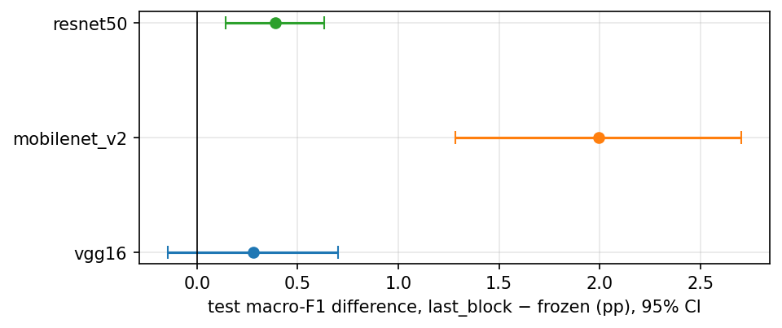</p>

### 5.6 Grad-CAM analysis 🔦

Grad-CAM is computed on the **best seed of each architecture, chosen by val macro-F1**, with target = the predicted class. The top rows show images all models classify correctly. The bottom rows show images at least one model gets wrong.

<p align="center">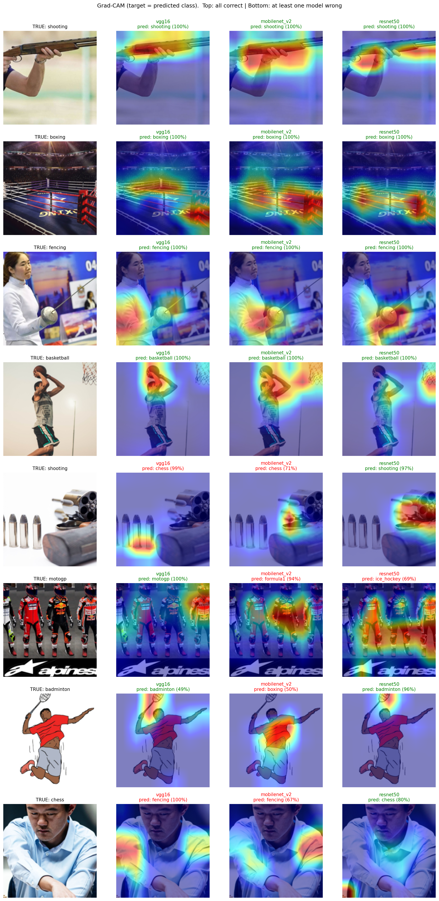</p>

**Findings:** ✏️
- ✏️ Is the heatmap on the athlete, ball, racket, car or chessboard, or on the background, text or spectators?
- ✏️ Do the three architectures look at different regions?
- ✏️ On misclassified images, does the model look at the wrong place?

### 5.7 Eyeball analysis: pre-trained vs. fine-tuned models 👁️

<p align="center">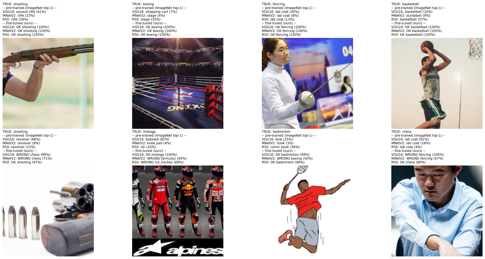</p>

✏️ *How do the original ImageNet predictions compare with the fine-tuned predictions on the same images?*

### 5.8 Error analysis

<p align="center">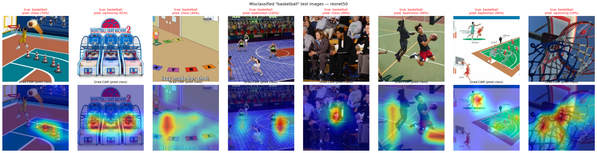</p>

✏️ *Weakest class, most-confused pairs (see 5.3), and likely causes: visually similar classes, several sports in one image, unusual angles, wrong labels, similar backgrounds.*

[🔝](#highlight)

---

## 6. Discussion💭

- **Which architecture works best:** ResNet50 > MobileNetV2 > VGG16 on test Macro-F1 (96.64 / 95.34 / 92.76%), and all three pairwise gaps are significant after Bonferroni (5.4). The residual design lets ResNet50 learn deep features that transfer well. VGG16's plain stack ends in a 25,088-d flattened map, which makes the head large and prone to overfitting (train–val gap +5.1 pp vs. ≈ +2 pp for the others).
- **Fine-tuning does not help equally:** unfreezing the last block helps MobileNetV2 the most (+1.99 pp, d = 4.1), helps ResNet50 a little (+0.39 pp) and gives no significant gain for VGG16 (+0.28 pp, p_adj = 0.47). MobileNetV2's last block includes the final 1×1 conv that produces the 1,280-d features, so unfreezing it adapts the feature space directly. ResNet50's frozen features are already strong (96.25%), which leaves less room to improve.
- **Accuracy vs. size vs. speed:** MobileNetV2 has about 10× fewer parameters (2.55M vs. 24.56M) and is about 3.3× faster (1.78 vs. 5.84 ms/img), for 1.30 pp lower Macro-F1. That makes it the better fit for a mobile or on-device app, while ResNet50 suits a server where accuracy matters most. VGG16 is the largest and slowest model and also the least accurate, so it has no use case here.
- **Possible under-training:** the best validation epoch often falls at the end of the 12-epoch budget, for MobileNetV2 `last_block` (best epochs 12, 7, 11, 7, 12) and especially VGG16 `frozen` (12, 12, 12, 11, 10). Validation F1 was likely still improving, so a longer schedule (e.g. 20–30 epochs) could raise these scores. The VGG16 `frozen` result may therefore be underestimated, which could partly explain why its ablation gap is not significant.
- **Fair comparison by design:** each strategy got its own sweep with the same budget, and the main model's strategy was selected on validation only. The test set never influenced any choice.
- **Limitations:**
  - With n = 5 seeds, statistical power is low.
  - The p-values and CIs reflect only training randomness (initialization, batch order, augmentation), not variation from sampling the data, because the split is fixed and each sweep used a single seed.
  - 10 sweep runs per architecture × strategy may not find the optimum.
  - Several selected learning rates lie near the edge of the search range [1e-4, 2e-3]: VGG16 `frozen` 1.28e-4 sits near the lower bound, while VGG16 `last_block` 1.50e-3, MobileNetV2 `last_block` 1.70e-3 and MobileNetV2 `frozen` 1.52e-3 sit near the upper bound. The optimum may lie outside the range, so a wider search (e.g. [3e-5, 1e-2]) is left for future work. The unfrozen block is trained at only `lr × 0.1` (≤ 2e-4), which may also limit how much fine-tuning can adapt the backbone.
  - ✏️ Any dataset limitation, e.g. near-duplicates found in 2.3, or web-image bias.

[🔝](#highlight)

---

## 7. Conclusion📝

<!-- AUTO:conclusion -->
- We compared 3 pre-trained CNNs (VGG16, ResNet50, MobileNetV2) on a 10-class sport dataset, each tuned with its own W&B Sweep per strategy.
- Ranking by mean test Macro-F1: ResNet50 (96.64 ± 0.19%) > MobileNetV2 (95.34 ± 0.54%) > VGG16 (92.76 ± 0.15%).
- Best model: **🏆ResNet50** (last_block); ResNet50 vs. MobileNetV2: p = 0.0037, significant after Bonferroni.
- Strategy chosen on validation per model: ResNet50 → `last_block`, MobileNetV2 → `last_block`, VGG16 → `last_block`.
<!-- /AUTO:conclusion -->
- ✏️ Grad-CAM shows that …
- ✏️ Error analysis shows that …

### ⏩ Future work
- ✏️ e.g. collect more images or hard examples for the weakest class, unfreeze more layers, train for more epochs, try newer backbones (EfficientNet, ConvNeXt, ViT).

[🔝](#highlight)

---

## 8. References🌐

**Libraries:** PyTorch, torchvision, scikit-learn, SciPy, pandas, NumPy, Matplotlib, Weights & Biases, pytorch-grad-cam, torchinfo, Pillow, icrawler (data collection), CLIP via Hugging Face (data filtering)

**Versions:** ✏️ *paste the version line printed by the first code cell, e.g.* `Python 3.x | PyTorch 2.x | torchvision 0.x`

1. Simonyan, K., & Zisserman, A. (2015). **[Very Deep Convolutional Networks for Large-Scale Image Recognition](https://arxiv.org/abs/1409.1556)**. ICLR.
2. He, K., Zhang, X., Ren, S., & Sun, J. (2016). **[Deep Residual Learning for Image Recognition](https://arxiv.org/abs/1512.03385)**. CVPR.
3. Sandler, M., Howard, A., Zhu, M., Zhmoginov, A., & Chen, L.-C. (2018). **[MobileNetV2: Inverted Residuals and Linear Bottlenecks](https://arxiv.org/abs/1801.04381)**. CVPR.
4. Selvaraju, R. R., et al. (2017). **[Grad-CAM: Visual Explanations from Deep Networks via Gradient-based Localization](https://arxiv.org/abs/1610.02391)**. ICCV.
5. Shorten, C., & Khoshgoftaar, T. M. (2019). **[A survey on Image Data Augmentation for Deep Learning](https://doi.org/10.1186/s40537-019-0197-0)**. Journal of Big Data, 6(60).
6. Gildenblat, J., & contributors (2021). **[PyTorch library for CAM methods](https://github.com/jacobgil/pytorch-grad-cam)**. GitHub.
7. Biewald, L. (2020). **[Experiment Tracking with Weights and Biases](https://www.wandb.com/)**.
8. Radford, A., et al. (2021). **[Learning Transferable Visual Models From Natural Language Supervision](https://arxiv.org/abs/2103.00020)** (CLIP). ICML.
9. Chen, K., & contributors. **[icrawler: A multi-thread crawler framework](https://github.com/hellock/icrawler)**. GitHub.
10. ✏️ Assoc. Prof. Thitirat ✏️ (2026). DADS7202 Deep Learning course materials (MLP2, CNN1, CNN2 examples). GSAS, NIDA.

---

## Citing

```bibtex
@misc{sportcnn2026,
  author = {✏️ Member 1 and Member 2 and Member 3 and Member 4},
  title  = {Sport Image Classification with CNN: Transfer Learning vs. Fine-tuning},
  year   = {2026},
  url    = {https://github.com/✏️/✏️}
}
```

---

<a id="members"></a>
## 👥 Members, Percent Contribution and Responsibility

| Student ID | Name | Contribution | Responsibility |
|---|---|:-:|---|
| ✏️ | ✏️ | ✏️ % | ✏️ e.g. data collection & cleaning |
| ✏️ | ✏️ | ✏️ % | ✏️ e.g. VGG16 experiments, W&B sweeps |
| ✏️ | ✏️ | ✏️ % | ✏️ e.g. ResNet50 / MobileNetV2 experiments |
| ✏️ | ✏️ | ✏️ % | ✏️ e.g. Grad-CAM, error analysis, slides & README |

---

<a id="end-credit"></a>
## 🖇️ End Credit

This project is part of **DADS7202 Deep Learning, Semester 1/2026 (1/2569)**, Master of Science in Data Analytics and Data Science (DADS), **Graduate School of Applied Statistics (GSAS), National Institute of Development Administration (NIDA)**.
